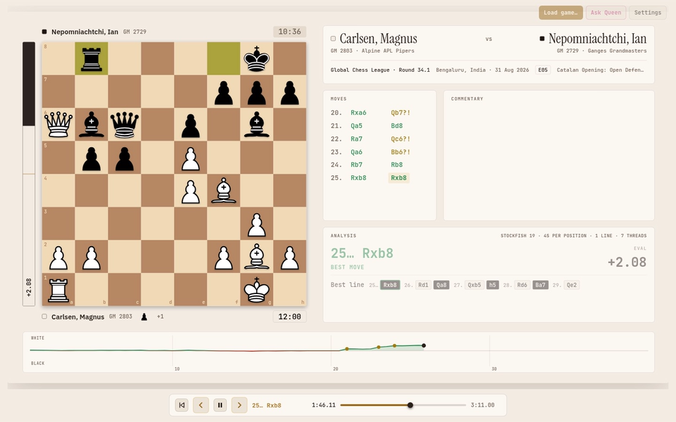

# Chess Replay

A browser app for replaying chess games. Load a PGN (one with a `[FEN]` start position too; Chess960 not yet) to step through it on an animated board, with an evaluation graph, a rating for every move and the opening name. Stockfish runs in your browser to analyse games that don’t have evals, and any game can be exported as an MP4 video or animated WebP.

## Build

Needs Node 22 or later; nothing to install (Babel and Stockfish are in the repo) and no network.

1. `git clone https://github.com/boneyland/chess-replay && cd chess-replay`
2. `node build.cjs`, which writes
   - `out/chess-game-video.html`: the [claude.ai artifact](https://claude.ai/artifact/5yXwsRkre66WZZ8AEmLrqT), ~3.9 MB with the engine and sounds inlined (base64 wasm, started from Blob URLs)
   - `out/site/`: the self-hosted copy, which Render builds from this repo (`render.yaml`) and serves at https://chess-replay.onrender.com/: `chess-game-video.html`, plus `stockfish-19-lite-single.js` and `.wasm` (loaded from next to the page), and a web app manifest with its icons (from `app/icons/`), so Add to Home Screen opens it without the browser's bars
3. Serve `out/site/` over HTTP, e.g. `python3 -m http.server 8765 --directory out/site`, and open http://localhost:8765/chess-game-video.html (don't open the file directly: browsers won't load the engine from a `file://` page)

Hosting `out/site/` anywhere static works the same. Ask Queen's Hugging Face sign-in only returns to URLs registered with an OAuth app, so on your own host it calls Queen without signing in, unless you register an app and put its client ID in `HF_OAUTH` (`app/queen.jsx`); a static Hugging Face Space with `hf_oauth: true` in its README supplies its own.

## Layout

- `app/`: page sources (`shell.html`, JSX components, `chess-core.js`, trimmed `sample-analysis.js`; `analysis-core.js`, `openings-core.js`, `sf-engine.js`, `stockfish.jsx` for Stockfish in the browser; `queen-core.js` parses Ask Queen's answers; `sfx-core.js` and `sfx.jsx` play the move sounds)
- `src/`: files from the original Claude Design project (`pieces.js`, `sample-game.js`, and `game-data.js`, which writes the sample game's commentary, `window.SAMPLE_NOTES`, all built into the page); `pieces/cburnett/` are Colin M.L. Burnett's pieces (GPL-2.0-or-later, as in Lichess)
- `babel/babel.min.js`: @babel/standalone 7.29.0, used only to precompile the JSX (sha256 `2623a9e22809915ce789b4461154e277ddce520d5a4320c14d44332a5d0dcea0`)
- `vendor/`: stockfish.js v19.0.1 `lite-single` (GPL-3.0, https://github.com/nmrugg/stockfish.js), unchanged release files
  - `stockfish-19-lite-single.js` sha256 `ccb130d7ff29408531c47d859a49f91d59d4f482d05a53eb1a3231a4f624c91a`
  - `stockfish-19-lite-single.wasm` sha256 `ee4f115bdb2d32cadf96cada104a05b5ec257d7ad6f57582190b49bc71f096de`
- `vendor/webp_enc_simd.*`: the WebP export's encoder, libwebp 1.1.0 (BSD-3-Clause, `webp_enc_simd.LICENSE`) built to WebAssembly by Squoosh, unchanged files from `codec/enc/` in @jsquash/webp 1.5.0 (Apache-2.0, https://github.com/jamsinclair/jSquash); the site serves them next to the page. `tests/fixtures/webp_dec.*` is the same package's decoder, used only by the tests
  - `webp_enc_simd.js` sha256 `3038e60ebba6252baba08c691e31d1efe5036a185435daa7b4afaef3cc9273f9`
  - `webp_enc_simd.wasm` sha256 `39c279269ec1163b987b6d69749458e3d5b03b9585f58b6ca5455b76b504a305`
- `vendor/sounds/`: Lichess's futuristic, nes, piano and sfx sound sets by Enigmahack (AGPL-3.0-or-later, per lila's `COPYING.md`), unchanged files from `public/sound/` at lila commit `b003cfa2fab3a07ed6192e9edb8544f012b38e7f`; the page inlines them. Lichess's other sets aren't free (standard, woodland, robot, instrument) or are non-commercial (lisp), so they're left out. The built-in Wood set is synthesized in `sfx-core.js`
  - `futuristic/Move.mp3` sha256 `e68edeb6dfc9d0510b553c7d94adbb249c07e52c8e1c6ae1a207dea56c08195a`
  - `futuristic/Capture.mp3` sha256 `d043743b359844536b991600253453de9d3f95d6ca4688f25ec3eebcf0316874`
  - `futuristic/Check.mp3` sha256 `dcc348cfb2f84bfa12daab3ea40b2970c41e9b33df8818a7788774bf485c312d`
  - `futuristic/Victory.mp3` sha256 `43abe23ee2bce78b99ba1977429c7ddfe36b4f7f0dd41b37b5e2f341ca86607c`
  - `futuristic/Draw.mp3` sha256 `e935da7d2bd2b096f42ed25ed7113fe307e930b4093bb2dd85b039a7e99906b3`
  - `nes/Move.mp3` sha256 `dd2537a1fe4e769cf81f2243a886869cecc747c03fc74302c26e82d1d30444f0`
  - `nes/Capture.mp3` sha256 `db0fee5a96c0638548e2f2522dce6541ca0e6a3cf75b50e0092817d9e00ecbb9`
  - `nes/Check.mp3` sha256 `0d7f8760ffafa45baf1a7e9deafa398bf3aedbe76ab5bd0dbf03055c2697d6ef`
  - `nes/Victory.mp3` sha256 `902489d7f8fc96cd557040124e9b67c5095242f4af339c267e8ae3bb1851fc67`
  - `nes/Draw.mp3` sha256 `779829a228c50d920345017b3e0bfecc519772be3d1ea5b61bc3e0d74f38b1f6`
  - `piano/Move.mp3` sha256 `2c681c2638ddaf4e18deebc36e5a2ee481c69ef6c6435597e672b73c5c078715`
  - `piano/Capture.mp3` sha256 `3fe6ce347463fe2e1f31bdbcd936945b3e550c97569ac8d5e6b7ac3487a5f244`
  - `piano/Check.mp3` sha256 `5f92c1c4b0e0d2af07de5d4b00702b16a4e77f83d4577cfce0d655b5acc1ccd0`
  - `piano/Victory.mp3` sha256 `71e06cd46e18fa9472b0fbd058ac88f4b1a07ecdff6bb45d413694fd23afa729`
  - `piano/Draw.mp3` sha256 `ba37adde8771a249d2389bc2d69c3673b5724c6450fa2b153db4d08dec47ccec`
  - `sfx/Move.mp3` sha256 `0b4bbf4b0bc0cd937f9661820da4f6e9c5b821913a32502d3b571e6730f7c984`
  - `sfx/Capture.mp3` sha256 `59b9de82710ea30968312902bf7ac8334a1da620ee364e231ef9454f8648f2d2`
  - `sfx/Check.mp3` sha256 `efaa7ae9a88025b6678de680441d806ce55e1a49f9009305235c5cd63a226093`
  - `sfx/Victory.mp3` sha256 `1821e541f533e3e6214d9b05a80b2edc3600ce1fbf8700d014315c9570b93d72`
  - `sfx/Draw.mp3` sha256 `cd8f8a02a63a94ab221cb01ebe1679771c83329cb4ce0549b78fc119aa1c2883`
- `openings-data.cjs`: embeds `openings/*.tsv` (Lichess chess-openings, CC0; a copy of chess-animator's) into the page
- `render.yaml`: the Render static site's settings (a Blueprint: Render syncs them from this file)
- `docs/`: design and plan for browser Stockfish (2026-10-16, written when this was `artifact/` in chess-animator; their paths are now repo-root paths)
- `media/preview.webp`: the README preview, the sample game playing moves 25–29 (1440×900 page at 2× pixel density, scaled to 1676 wide to fill GitHub's 838 px README column on 2× screens; 12 fps, WebP quality 90)
- `games/`: local PGNs (not committed)
- `tests/`: `node --test --test-concurrency=1 tests/*.test.cjs` (GitHub Actions runs these on every push, and the Render build before building), then `../chess-animator/.venv/bin/python -m unittest tests/check_browser_json.py` (from the repo root). The Python checks import chess-animator, which must be checked out next to this repo. `make_rating_expected.py` and `make_openings_expected.py` regenerate the fixtures from the Python code. Building doesn't need chess-animator. `tests/live/site.test.cjs` smoke-tests the live site (or `LIVE_URLS=local`, a local build) in Chromium and Firefox with Playwright; GitHub Actions runs it on each push against that commit's build.

Licence: GPL-3.0-or-later (`LICENSE`), the same as the bundled Stockfish. The Lichess sound files keep their own licence, the AGPL-3.0-or-later, which GPL-3.0 section 13 allows them to be combined with. The WebP encoder keeps libwebp's BSD-3-Clause and the Squoosh glue's Apache-2.0 licences, both compatible with the GPL-3.0.
